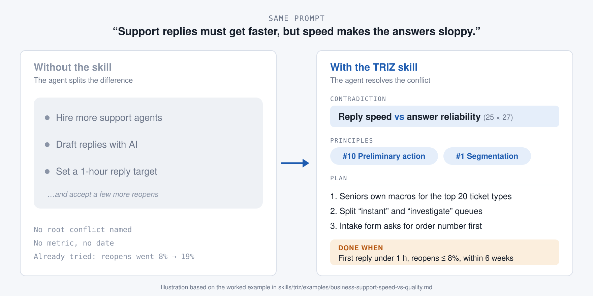
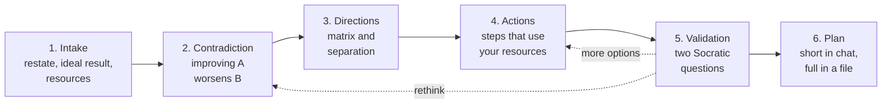
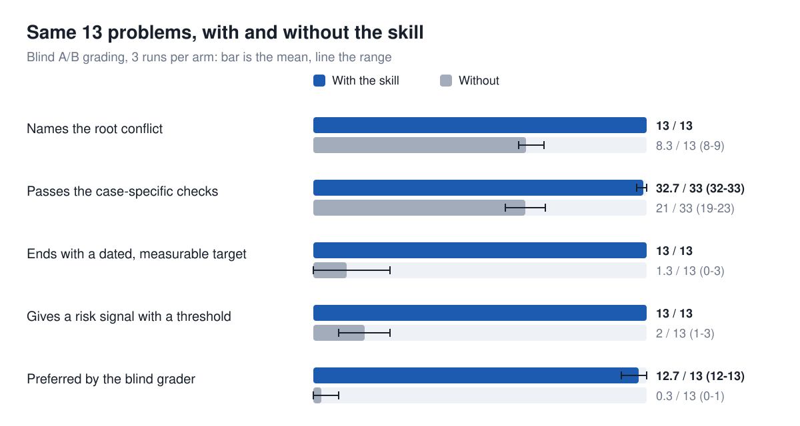

<p align="center">
  <picture>
    <source media="(prefers-color-scheme: dark)" srcset="assets/logo-dark.svg">
    
  </picture>
</p>

<h1 align="center">TRIZ skill</h1>

<p align="center">
  <strong>Your agent gets stuck on trade-offs. TRIZ finds the way out.</strong>
</p>

<p align="center">
  <a href="https://github.com/magery-ai/triz-skill/releases/latest"></a>
  <a href="LICENSE"></a>
  <a href="https://github.com/magery-ai/triz-skill/actions/workflows/validate.yml"></a>
  <a href="https://agentskills.io"></a>
  <a href="#install"></a>
  <a href="https://github.com/magery-ai/triz-skill/stargazers"></a>
</p>

<p align="center">
  <a href="#install">Install</a> ·
  <a href="#see-it-work">Example</a> ·
  <a href="#how-it-works">How it works</a> ·
  <a href="#results">Results</a> ·
  <a href="#faq">FAQ</a>
</p>

<p align="center">
  
</p>

When you ask an agent to fix a trade-off, faster but not sloppier or lighter
but not weaker, it usually splits the difference. This
[agent skill](https://agentskills.io) teaches it TRIZ, the theory of inventive
problem solving. The agent finds the contradiction behind your problem and
looks it up in Altshuller's contradiction matrix and the 40 inventive
principles. It turns the results into steps that use what you already have,
checks them with you, and hands back a short plan and a full one.

## Install

**Ask your agent.** Paste this into Claude Code or any agent that supports
skills:

```text
Install the TRIZ skill from https://github.com/magery-ai/triz-skill
```

**Claude Code** (plugin marketplace):

```
/plugin marketplace add magery-ai/triz-skill
/plugin install triz@triz-skill
```

**Claude.ai:** download `triz-skill-<version>.zip` from the
[latest release](https://github.com/magery-ai/triz-skill/releases/latest) and
upload it under Settings > Capabilities > Skills.

**Any agent** with the [skills CLI](https://skills.sh):

```bash
npx skills add magery-ai/triz-skill --skill triz
```

**Agents without skill support** (Cursor rules, Copilot, Windsurf, Cline):
copy [`agents/AGENTS.md`](agents/AGENTS.md) into your project.

Manual install and other options are in [INSTALL.md](INSTALL.md).

Then describe a problem where improving one thing makes another worse, for
example: *"Our pages need to be fast, but the cache shows stale prices."*

## See it work

| Problem | Contradiction | What the agent proposed |
|---|---|---|
| [Support replies faster without sloppy answers](skills/triz/examples/business-support-speed-vs-quality.md) | Reply speed against answer reliability | Senior-owned macros plus split queues (#10, #1) |
| [Fast product pages with fresh prices](skills/triz/examples/software-cache-vs-freshness.md) | Response time against data freshness | Purge on change from the admin tool, TTL as fallback (#24, #26) |
| [Halve the inference bill without worse answers](skills/triz/examples/software-model-router.md) | Serving cost against answer reliability | Route easy ticket types to a small model, escalate doubtful answers (#35, #11) |
| [OCR cost with LLM accuracy for invoices](skills/triz/examples/software-ocr-vs-llm.md) | Cost per page against extraction accuracy | OCR with supplier templates and field checks; LLM only where a check fails (#28, #34) |
| [Longer wind turbine blades without the weight](skills/triz/examples/engineering-wind-turbine.md) | Blade length against blade weight | Carbon caps only in the outer 10 m plus bend-twist layout (#40, #15) |

<details>
<summary><strong>Read a full session</strong> (support team, about 6 replies)</summary>

> **You:** Our support team has to answer tickets faster, but every time we
> push for speed the answers get sloppier and customers write back.
>
> **Agent:** Let's work through this with TRIZ. Two quick questions first,
> one at a time. What does "fast" mean for you today, and what is the target?
>
> **You:** First reply takes about 9 hours. We want under 1 hour.
>
> **Agent:** What have you already tried, and what can't change?
>
> **You:** We set a 1-hour target. Replies got faster, but reopen rates went
> from 8% to 19%. No new hires this year, we use Zendesk, and senior agents
> are our best asset.
>
> **Agent:** Here's my restatement. A team of fixed size has to cut first reply
> time from 9 hours to under 1 hour without raising the reopen rate above 8%.
> **Ideal result:** every customer gets a correct answer at once, with no extra
> staff. **Resources:** Zendesk macros and triggers, ticket history, senior
> agents' knowledge.
>
> The contradiction behind it: improving **speed** (parameter 25, Loss of
> time) worsens **reliability** (27, Reliability) of the answers. In physical
> form: the reply must be *instant*, so agents don't investigate, and
> *considered*, so it is correct. Is that the problem, and does the conflict
> match what you see?
>
> **You:** Exactly that.
>
> **Agent:** Speed here is the time customers wait (25, Loss of time) or
> tickets handled per hour (39, Productivity). Reading both matrix cells against
> 27 Reliability, #10 shows up in both, so I'll lead with it, then #1 from
> the second cell:
> - **#10 Preliminary action:** do the investigating before the ticket arrives.
> - **#1 Segmentation:** split tickets that can be answered instantly from those
>   that can't.
>
> Concrete options, ranked:
> 1. Seniors write and own macros for the 20 most common ticket types, which
>    cover about 60% of volume (#10). Low effort, high fit.
> 2. A Zendesk trigger routes tickets that match a macro to an "instant" queue
>    and everything else to "investigate", with an honest 4-hour promise (#1).
> 3. An intake form asks for the order number and a screenshot before a human
>    sees the ticket (#10).
>
> One question before we commit: who would object to option 1, and why?
>
> **You:** Seniors might hate writing canned replies.
>
> **Agent:** What if they own them instead: each senior maintains five macros
> and reviews reopen data for them weekly? Does that answer the objection?
>
> **You:** Yes, they'd like owning the quality numbers.
>
> **Agent:**
> **Short plan: support speed without losing quality**
> **Contradiction:** improving speed worsens answer reliability
> **Chosen solution:** senior-owned macros plus split queues (#10, #1)
> **Next steps:**
> 1. Pull the top 20 ticket types from last quarter (team lead, Friday)
> 2. Each senior writes and owns five macros (seniors, in 2 weeks)
> 3. Add the instant/investigate trigger in Zendesk (admin, in 2 weeks)
>
> **Resources:** Zendesk macros and triggers, last quarter's ticket history, seniors' time (about 2 hours each); new: nothing
> **Watch for:** reopen rate on macro tickets above 8% for a week, then pull that macro for review
> **Done when:** median first reply under 1 hour with reopen rate at or below 8%, within 6 weeks
>
> I saved the full plan, with the analysis, options and validation log, to
> `triz-plans/2026-10-21-support-speed-vs-quality.md`.

</details>

## How it works



The agent stops to check with you three times: after it restates the problem,
after it names the contradiction, and before it commits to an option. A
guided session takes about 5-8 of your replies.

Every plan has three required fields: **Resources** (what it uses, and
anything new with its cost), **Watch for** (the top risk, a measurable signal
and what to do) and **Done when** (a metric, a target and a date). The full
plan is saved to `triz-plans/YYYY-MM-DD-<slug>.md` in your project.

| Mode | When to use it | What changes |
|---|---|---|
| **Guided** (default) | You want to think it through | Every check, at most two questions at each |
| **Fast** | Say "just give me options" | One check, and you can skip validation |
| **Autonomous** | No human in the loop | The agent answers its own checks, lists its assumptions and flags low-confidence plans |

## Results

<p align="center">
  
</p>

We ran all 13 eval cases with and without the skill and had a separate agent
grade the two conversations blind. With the skill, every plan named the
conflict, set a dated target and gave a risk threshold, and the grader
preferred it in 11 of 13 cases. It takes about three more of your replies.
Both losses were in autonomous mode. This is one run per arm with simulated
users, so read it as a first signal. See the
[full results and method](evals/results/2026-10-21.md).

## FAQ

**Can't my agent do this without the skill?**
It knows what TRIZ is, but left alone it tends to trade one side off against
the other or give a generic list. The skill makes it name the contradiction,
look up the actual matrix cell, tie each option to your resources and end with
a plan you can measure. In our evals, plans without the skill had a dated
target in 7 of 13 cases; with it, 13 of 13. See [Results](#results).

**Is it only for engineering?**
No. A mapping guide translates software, business and personal problems into
TRIZ parameters, and the examples above cover all three kinds.

**How accurate is the contradiction matrix?**
Three independent copies agree on 1,492 of 1,521 cells. The other 29 are
marked as disputed, and the agent shows both values. The cells have not yet
been checked against the 1997 book. See [Sources](#sources).

**Does it need Python?**
No. A small lookup script (standard library only) makes matrix lookups
faster. Agents that can't run scripts read the data files directly.

**Where does the plan go?**
The short plan stays in the chat. The full plan, with the analysis and the
validation log, goes to `triz-plans/` in your project, or into the chat if the
agent has no file access.

## Contributing

Worked examples, eval cases and matrix corrections are welcome. See
[CONTRIBUTING.md](CONTRIBUTING.md) for the repository layout and how to run
the tests, and [CHANGELOG.md](CHANGELOG.md) for what changed in each release.
To report a wrong matrix cell, open a
[Wrong matrix cell](https://github.com/magery-ai/triz-skill/issues/new?template=wrong-matrix-cell.yml)
issue.

## Sources

The skill uses only the classic 1971 Altshuller 39x39 contradiction matrix and
the 40 inventive principles. Descriptions and data are written in this
project's own words and format.

Matrix values come from the [triz40.com](https://www.triz40.com/aff_Matrix_TRIZ.php)
online matrix (Source: TRIZ40 - www.triz40.com), cross-checked cell by cell
against a second copy. Differences are logged in
`skills/triz/data/matrix-discrepancies.md`. A third copy with a documented
origin, the table on the [G.S. Altshuller Foundation](https://www.altshuller.ru/triz/technique2.asp)
site (from Altshuller's *Algorithm of Invention*, 1973), agrees on 1,492 of
1,521 cells; the 29 cells where it differs are marked `disputed`, and the
lookup script says so. The cells have **not** yet been checked against the primary
reference, Altshuller's *40 Principles* (Shulyak and Rodman, 1997);
`skills/triz/data/matrix-status.json` tracks each cell's status. If you have
the book and find a difference, please open a
[Wrong matrix cell](https://github.com/magery-ai/triz-skill/issues/new?template=wrong-matrix-cell.yml)
issue.

## License

[MIT](LICENSE)

## Star history

<a href="https://star-history.com/#magery-ai/triz-skill&Date">
  <picture>
    <source media="(prefers-color-scheme: dark)" srcset="https://api.star-history.com/svg?repos=magery-ai/triz-skill&type=Date&theme=dark">
    
  </picture>
</a>
